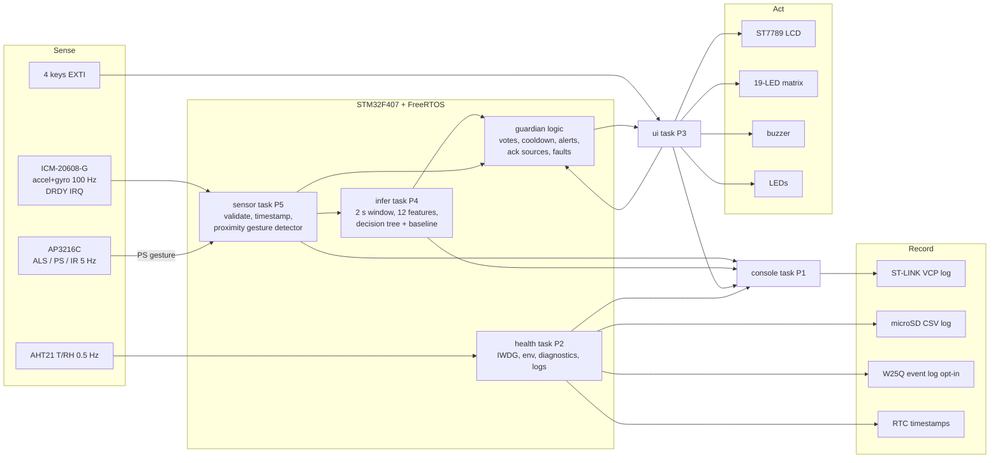

# Smart Item Guardian — product concept and design

> **Scope (revised 2026-11-18).** Smart Item Guardian is a **handheld handling-warning prototype**. It is the bare RT-Spark board: there is **no enclosure**, and it has **not been validated mounted to or inside an item** (box, bag, case). The earlier box/lid concept, including lid OPEN/CLOSED detection, was removed from the product. Every recording (S01–S06) was made with the bare board held by hand, which matches this scope.

## Problem, user, environment, goal

People who carry or move fragile or valuable things (a camera, a lab instrument, a sample kit) often find out only later that the item was handled roughly. Smart Item Guardian is a small handheld warning device that is moved together with the item, or held while the item is handled. It works indoors at room conditions on USB power. It classifies the handling **on the STM32 itself** with a compact decision tree — **STATIONARY**, **NORMAL_HANDLING** or **ROUGH_HANDLING** — and warns at once on rough handling with LCD text, the LED matrix, the status LED and the buzzer. The user silences an alert with the DOWN key or, without touching the device, by **holding a hand over the light/proximity sensor** (touchless acknowledgement). Events are counted and logged. No network or phone is needed.

## Alternatives considered

| idea | why not chosen |
|---|---|
| Study-desk posture/presence assistant (AP3216C + IMU) | Proximity alone cannot classify posture well, and labels would be subjective. |
| Home environment comfort assistant (AHT21 + light) | The useful decision is a threshold, which leaves little real need for a trained classifier. |
| Box guardian with lid open/closed context (original concept) | Removed: no enclosure was built or validated, and lid detection was never verified. |
| **Handheld handling warning (chosen)** | Handling has distinct, measurable motion signatures that the IMU captures well; the three classes are safe to reproduce gently; the response (warn now, count, log, acknowledge) is directly useful. |

## Classification states (the model's labels)

| state | definition used for labelling | safe way to produce it |
|---|---|---|
| STATIONARY | The board rests on a surface and nobody touches it. Ordinary room vibration is allowed. | Put it down on the table, hands off. |
| NORMAL_HANDLING | Calm, intentional handling: lifting, carrying, turning, setting down gently, sliding. | Handle calmly. |
| ROUGH_HANDLING | Vigorous shaking, abrupt jerk-stops and fast twists. | Hold firmly with two hands and shake or jerk. **Never drop, throw or strike it.** |

Real drops and impacts are deliberately **not** reproduced, so the model has never seen them. The product is an experimental handling monitor, not a certified shock or drop detector. The model (`dt-adfe15c9f6`) was trained and tested on bare-board handling only.

## Touchless acknowledgement (AP3216C proximity)

The AP3216C proximity channel (10-bit PS counts, read at 5 Hz) recognises one **deliberate gesture**: the hand must first be away (FAR for 3 readings, 0.6 s), then come close and **stay close for 3 readings (0.6 s)**. The gesture fires once; the detector then waits until the hand has been away again for 0.6 s (`src/core/prox_ack.c`). Consequences:

- a hand or object that **stays near never triggers repeatedly** (and something already near at start never triggers);
- a brief pass of the hand (< 0.6 s) does not trigger;
- NEAR/FAR use two thresholds (hysteresis), invalid readings (IR overflow, I²C error) are ignored.

A gesture acknowledges an alert only if the alert is active, unacknowledged and **at least 1 s old**, and not while the device is still shown as ROUGH (`gl_prox_ack` in `src/core/guardian_logic.c`). Every gesture is logged with the reason it did or did not acknowledge.

**Thresholds are not invented.** Touchless acknowledgement stays **disabled until a measured calibration exists**: the `prox cal` wizard (or RIGHT held on the GUARD screen) measures the PS readings with hands away and with a hand held 2–5 cm over the sensor, requires a gap of at least 20 counts between the highest "away" and the lowest "near" reading, and places the FAR/NEAR thresholds at 1/4 and 1/2 of that gap. The result is stored in RTC backup registers; a failed calibration stores nothing. The buttons always work.

## Controls

| key | short press | hold 1.5 s |
|---|---|---|
| UP | raise a TEST alert (try the alert path and touchless acknowledgement) | — |
| DOWN | acknowledge the current alert | — |
| LEFT | next screen (GUARD → SENSORS → SYSTEM → MODULES) | — |
| RIGHT | screen action (SENSORS: gyro re-calibration; SYSTEM: task/heap report; MODULES: self-test) | GUARD: proximity calibration wizard |

GUARD screen (240 × 240 px): header; the predicted activity in a large colour box (STILL green, NORMAL cyan, ROUGH red with white text, FAULT orange); a full-width alert banner (red, orange for TEST, grey once acknowledged) with the acknowledgement hint; then hand-ack status, rough-event count, confidence with T/RH, a status line and the key legend. Diagnostics stay on the SENSORS / SYSTEM / MODULES screens.

The printed key labels match the firmware key names (verified in the final hardware session with a typed cross-check, `evidence/hardware/keymap_check/verify_20261118T080937Z.md`; the gate-1 ambiguity was a key-identification issue, no remap).

## Block diagram

## Acceptance criteria

These are the product's own criteria (the assignment sets no accuracy percentage); every value is checked by `tools/hw/final_test.py`.

| # | expected behaviour | error types that matter | measurement | target |
|---|---|---|---|---|
| A1 | Rough handling raises a local alert | **missed rough event** (worst: the user is not warned); a false rough alert (nuisance) | 20 guided rough trials; alert seen in the trial | ≥ 18/20 detected |
| A2 | Calm use does not alarm | false rough alerts during STILL/NORMAL trials | 40 trials | ≤ 2/40 false alerts |
| A3 | Displayed state matches the activity | STILL ↔ NORMAL confusion | trial-level confusion matrix, per-class recall | report; recall ≥ 0.8 each |
| A4 | Feedback is immediate | slow response | sample→alert delay (firmware), key→feedback | p95 < 100 ms (actuation), key p95 < 50 ms |
| A5 | Invalid sensor data never produce a prediction | a prediction from garbage | injected IMU fault | 0 valid predictions during fault; alert shown |
| A6 | Touchless acknowledgement is deliberate | missed gesture; repeated or accidental acknowledgement | 10 deliberate gestures; hand held near during 3 alerts; 15 s hands away | ≥ 9/10 acknowledged; 0 while held near; 0 with hands away |
| A7 | Robust operation | crash, hang, missed reads | ≥ 15 min continuous, IWDG never fires | 0 resets, 0 stalls |
| A8 | Works without any network | — | whole run with network off | inference continues |

## Risks

**Privacy.** The device records only motion counts, light/proximity levels, T/RH and event times on the device and over USB. It has no camera, microphone use, location, network or cloud. Training data use anonymous operator IDs. The RW007 Wi-Fi module is only presence-checked and never joins a network.

**Safety.** Data collection and tests use gentle, controlled simulations only: no drops, throws or strikes. The USB cable is kept slack and held together with the board. Matrix brightness is capped at 24/255 to avoid glare, and the buzzer patterns are short. The product is a prototype and must not be relied on to protect valuables or people.

**Accessibility.** Every alert is redundant across text, colour, flashing and a buzzer rhythm, so it does not rely on colour vision or hearing alone; alert types use distinct rhythms. The big-font state word (24×32 px) is readable at arm's length. Acknowledgement works with a physical key **or** a touchless hand gesture (useful when the hands are busy or gloved). Limitation: there is no haptic output for deaf-blind users.

## Measured outcome (final hardware session, 2026-11-18)

Evidence: `evidence/hardware/final_20261118T081218Z/`, `prox_check_20261118T081020Z/`. Handheld, bare board.

| # | result | met? |
|---|---|---|
| A1 | 16/20 rough alerts inside the protocol window; the other 4 fired 0.2–1.6 s before the start beep (shaking began during the countdown) | not under the strict definition |
| A2 | 4/40 false rough alerts (all in NORMAL trials) | **no** |
| A3 | recall STILL 1.00, NORMAL 0.80, ROUGH 1.00 | yes (NORMAL at the limit) |
| A4 | sample → alert actuation p95 870 µs; key → feedback max 11 µs | yes |
| A5 | 0 valid predictions during the 20 s injected fault; FAULT screen and buzzer confirmed | yes |
| A6 | 10/10 gestures; 0 acknowledgements while a hand stayed near; 0 with hands away | yes |
| A7 | 25.6 min, 0 resets, 0 stalls, 0 missed samples | yes |
| A8 | 24.7 min uninterrupted on-device inference; device has no network; PC isolation not demonstrated (adapters reported Up) | device yes; protocol deviation recorded |

Proximity thresholds were derived by the board from measured readings (hands away 0–10 counts, hand over the sensor 1023): FAR ≤ 263, NEAR ≥ 516.
